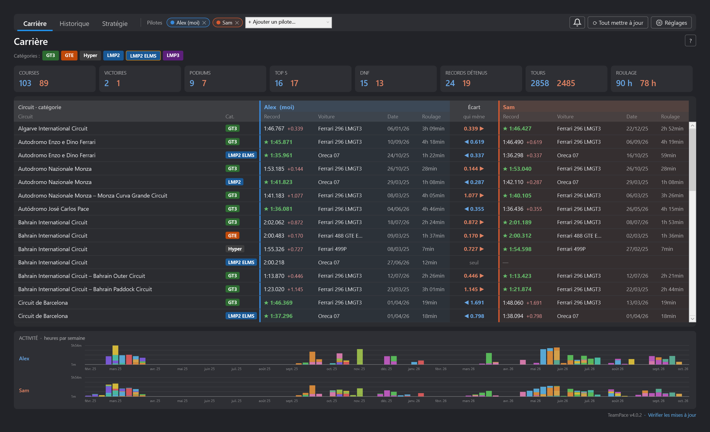
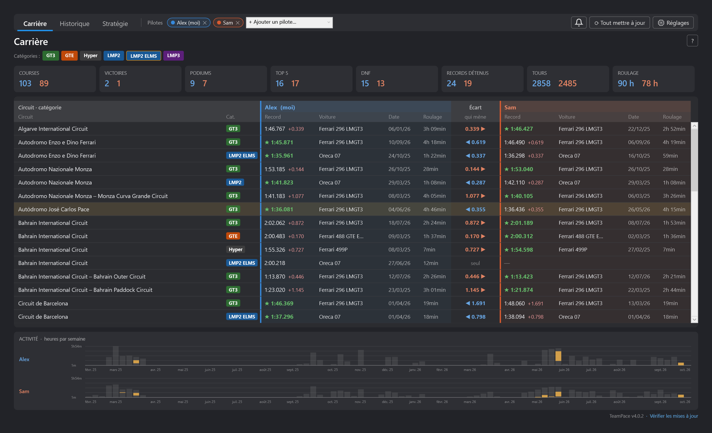
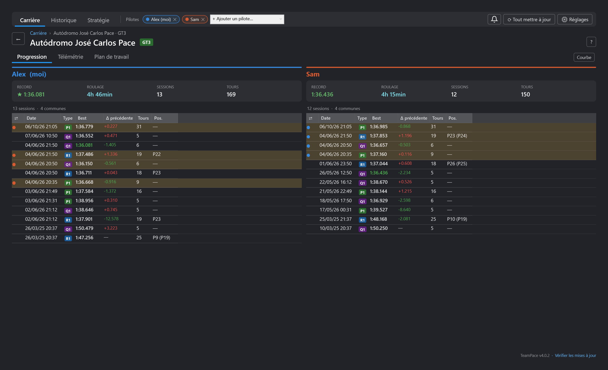
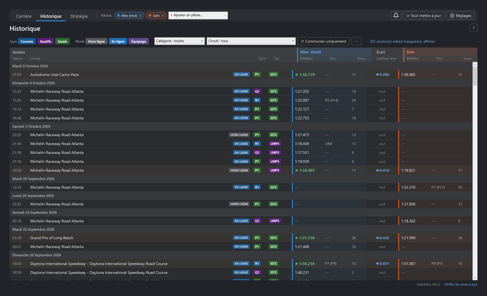
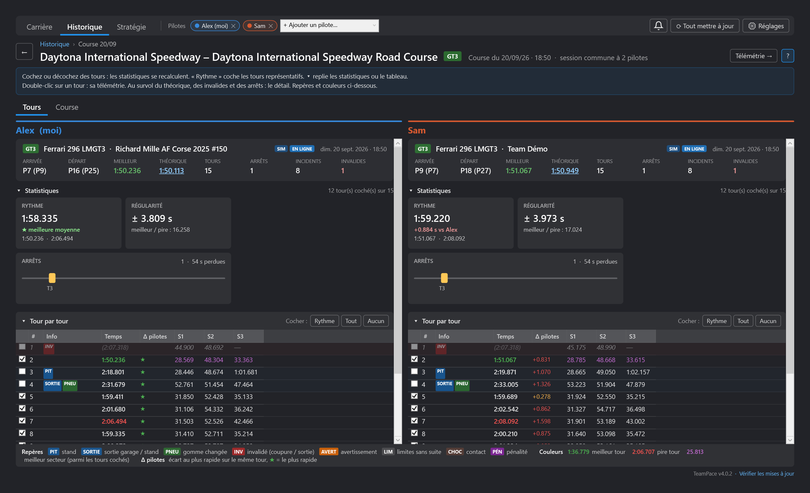
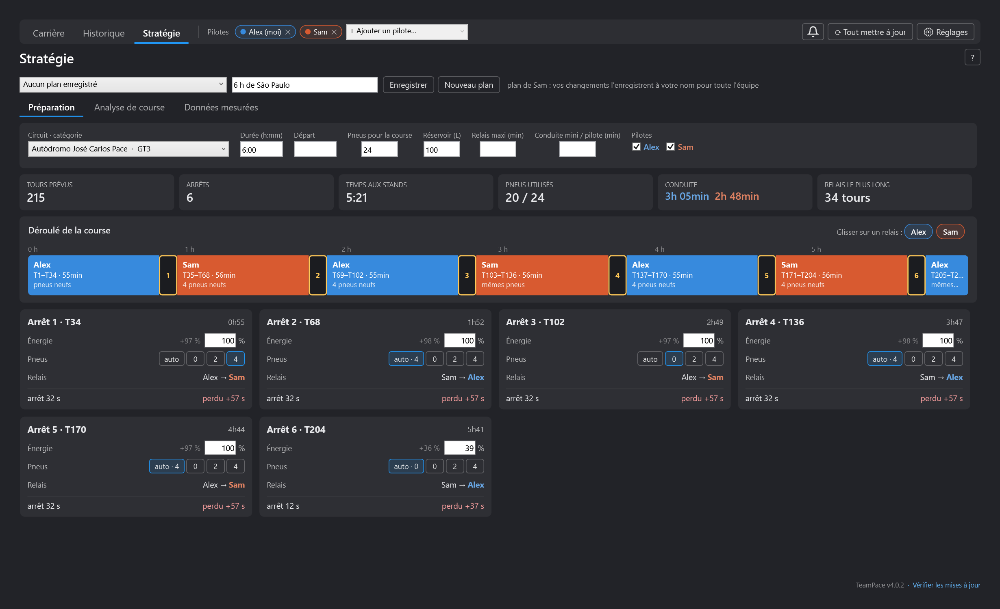
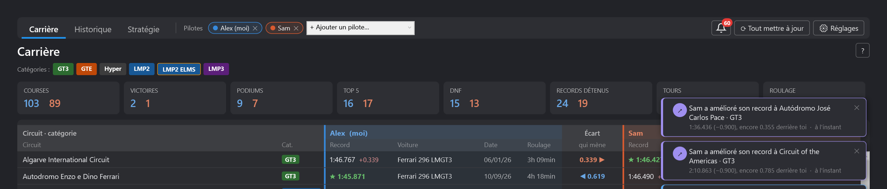
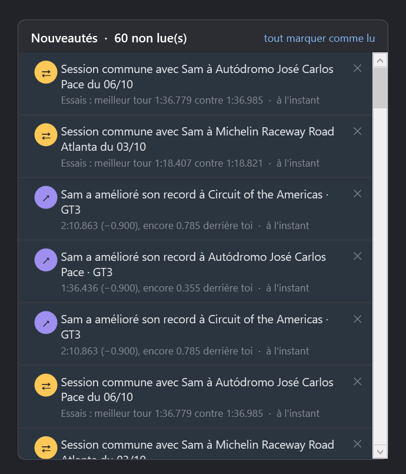
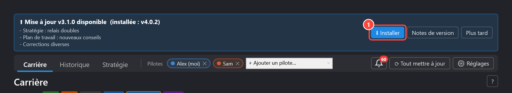

# TeamPace

**Comparez votre rythme à celui de vos coéquipiers sur Le Mans Ultimate.**

TeamPace est un plugin [SimHub](https://www.simhubdash.com/) fait pour un petit groupe de pilotes
qui se connaissent : votre équipe, vos amis. Chacun garde ses propres données, les partage via un
simple dossier Google Drive commun, et tout le monde peut se comparer côte à côte : carrière,
records, sessions courues ensemble, tour par tour, télémétrie. Les données servent aussi à préparer
les courses d'endurance : un planificateur calcule les relais à partir de vos propres mesures.



- [Ce que fait TeamPace](#ce-que-fait-teampace)
- [Installation](#1-installation)
- [Premiers réglages](#2-premiers-réglages)
- [Partager avec ses coéquipiers (Google Drive)](#3-partager-avec-ses-coéquipiers-google-drive)
- [Se comparer](#4-se-comparer)
- [Stratégie d'endurance](#5-stratégie-dendurance)
- [Notifications](#6-notifications)
- [Mises à jour](#7-mises-à-jour)
- [Dépannage](#dépannage)
- [Historique des versions](CHANGELOG.md)

## Ce que fait TeamPace

| | |
|---|---|
| **Comparaison entre coéquipiers** | jusqu'à 4 pilotes, une couleur par pilote, leurs résultats sur la même ligne |
| **Carrière face à face** | record de chacun par circuit et catégorie, qui mène et de combien, chiffres clés, activité semaine par semaine |
| **Historique** | une ligne par session, les sessions courues ensemble détectées automatiquement |
| **Progression** | les séances de chaque pilote sur un circuit, et la courbe de son meilleur tour |
| **Analyse tour par tour** | secteurs, écart au coéquipier sur chaque tour, carburant, énergie virtuelle, usure des pneus, arrêts aux stands |
| **Analyse de course** | la course face au plan de l'équipe, arrêt par arrêt, puis toutes les voitures : arrêts, relais, rythme, où le temps est parti |
| **Télémétrie** | n'importe quel tour de chaque pilote superposé : écart cumulé, vitesse, pédales, rapport, volant, régime, trajectoires sur la carte du circuit |
| **Plan de travail** | les trois virages où gagner du temps, avec la phase et la mesure en cause |
| **Stratégie** | planificateur d'endurance : relais, arrêts, énergie, pneus, à partir de vos mesures, modifiable à la souris |
| **Notifications** | records battus, victoires, sessions communes de l'équipe, en pop-up et sous la cloche |
| **Capture en direct** | pendant que vous roulez (SimHub ouvert) : litres par tour, usure par tour, temps dans la voie des stands et à l'arrêt |
| **Automatique** | chaque session terminée dans LMU est importée seule, serveurs privés compris |

TeamPace ne publie rien sur Internet : vos données ne vont que dans le dossier Google Drive
que **vous** partagez avec les personnes de **votre** choix.

## 1. Installation

1. Téléchargez **`User.TeamPace.dll`** depuis la [dernière version](../../releases/latest).
2. **Clic droit sur le fichier → Propriétés → cochez « Débloquer » → OK.**
   Windows bloque par sécurité les fichiers venus d'Internet ; sans cette étape, SimHub peut
   refuser de charger le plugin.
3. **Fermez SimHub**, puis copiez la DLL dans le dossier d'installation de SimHub
   (par défaut `C:\Program Files (x86)\SimHub\`).
4. Lancez SimHub et acceptez l'activation du nouveau plugin.
   **TeamPace** apparaît dans le menu de gauche.

C'est la seule installation manuelle : les versions suivantes s'installent depuis le plugin
([Mises à jour](#5-mises-à-jour)).

## 2. Premiers réglages


1. **⚙ Réglages** : ouvre ou replie ce panneau. Il est ouvert d'office au premier lancement, puis
   se replie pour laisser la place à vos données.
2. **Joueur LMU** : votre nom exactement comme dans Le Mans Ultimate.
3. **Dossier résultats** : le dossier des résultats LMU. Il est détecté automatiquement dans la
   plupart des cas (`…\Le Mans Ultimate\UserData\Log\Results`).
4. **⟳ Tout mettre à jour** (en haut à droite) : récupère toutes vos sessions passées, extrait la
   télémétrie enregistrée par LMU et synchronise l'équipe. La première fois, comptez une
   trentaine de secondes.

Ensuite, plus rien à faire : chaque session que vous terminez dans LMU est ajoutée toute seule,
télémétrie comprise.

## 3. Partager avec ses coéquipiers (Google Drive)

Le principe : un dossier Google Drive commun à l'équipe. Le plugin de chaque pilote y dépose
son fichier de données et y lit ceux des autres. Pas de serveur, pas de compte supplémentaire.

### 3.1 Installer Google Drive pour ordinateur (chaque pilote)

Téléchargez **Google Drive pour ordinateur** sur
[google.com/drive/download](https://www.google.com/drive/download/), installez-le et connectez-vous
avec votre compte Google. Votre Drive apparaît alors comme un **lecteur** dans l'Explorateur Windows.


### 3.2 Créer et partager le dossier d'équipe (le capitaine, une seule fois)

Sur [drive.google.com](https://drive.google.com) : **Nouveau → Nouveau dossier**, nommez-le par
exemple `LMU Équipe`, puis partagez-le avec chaque coéquipier **en tant qu'Éditeur**.


> « Éditeur » est indispensable : chaque pilote doit pouvoir déposer son propre fichier.
> Aide Google : [Partager des dossiers dans Google Drive](https://support.google.com/drive/answer/7166529).

### 3.3 Ajouter le dossier à son Drive (chaque coéquipier)

Un dossier partagé avec vous n'apparaît **pas** sur votre ordinateur tant que vous ne l'avez pas
ajouté à votre Drive. Sur [drive.google.com](https://drive.google.com) :
**Partagés avec moi → clic droit sur le dossier → Organiser → Ajouter un raccourci → Mon Drive**.


> Aide Google : [Raccourcis Google Drive](https://support.google.com/drive/answer/9700156).

### 3.4 Indiquer le dossier dans TeamPace (chaque pilote)

Dans TeamPace, cliquez sur **📁 Choisir…** et sélectionnez le dossier d'équipe dans le lecteur
Google Drive :


La synchronisation démarre aussitôt. Le dossier choisi s'affiche dans les **⚙ Réglages** :


1. **Dossier équipe** : le dossier partagé sélectionné.
2. **📁 Choisir…** : pour le changer.
3. **⟳ Tout mettre à jour**, en haut à droite : force l'échange tout de suite. Sinon, c'est
   automatique (au démarrage de SimHub, à la fin de chaque session et à la fermeture).
4. **Pilotes affichés** : vous et les coéquipiers ajoutés (voir ci-dessous).

## 4. Se comparer

### Se déplacer dans TeamPace

Trois onglets en haut : **Carrière** (point de départ), **Historique** (toutes les sessions) et
**Stratégie** (préparer une course d'endurance et la comparer à ce qui s'est passé). En dessous :

- un double-clic sur un circuit de la Carrière ouvre sa **page circuit** : *Progression*,
  *Télémétrie* et *Plan de travail* ;
- un double-clic sur une session ouvre son **analyse**, côte à côte si elle est commune, avec deux
  onglets pour une course : *Tours* et *Course*.

Pour remonter : le bouton **←**, le **fil d'Ariane** au-dessus du titre (chaque niveau est
cliquable), le bouton « précédent » de la souris ou **Alt + ←**. Les écrans n'ont pas de texte
d'aide : le bouton **?** en haut à droite déplie l'aide de l'écran en cours, et les info-bulles
donnent le détail.

### Ajouter un coéquipier à l'écran


**+ Ajouter un pilote…** liste les coéquipiers dont le fichier est arrivé dans le dossier d'équipe,
jusqu'à 4 pilotes affichés. Le **✕** sur son nom le retire. Leurs données sont en lecture seule :
vous ne pouvez rien modifier chez eux, et eux rien chez vous.

### Carrière, face à face


Les chiffres clés de chaque pilote côte à côte (roulage en heures), puis **une ligne par circuit et catégorie** avec le
record de chaque pilote sur la même ligne : un bloc teinté à sa couleur par pilote (record, voiture,
date, temps roulé). Le plus rapide est en vert (★), l'écart des autres en rouge ; la colonne
**Écart** indique qui mène et de combien. Les étiquettes de catégorie filtrent le tableau.



Un **clic** sur une ligne fait ressortir ce circuit dans l'activité de chaque pilote (heures par
semaine, une couleur par circuit) ; à l'inverse, un clic sur une barre de l'activité sélectionne sa
ligne. Un **double-clic** ouvre la page du circuit ; pour changer de circuit, on revient à la Carrière.

### Page circuit : progression



Pour chaque pilote : son **record**, son **roulage**, ses **sessions** et ses **tours** sur ce
circuit, puis ses séances, la plus récente en haut, avec l'écart à la séance précédente. Un clic
fait ressortir la séance chez tous les pilotes ; un double-clic l'analyse.

Le bouton **Courbe** (à droite des onglets) affiche le meilleur tour de chaque séance : une couleur
par pilote, **plus c'est bas, plus c'est rapide** (★ = record, anneau doré = séance commune).

### Historique



Une ligne par session, groupées par jour. Une session courue par plusieurs pilotes affichés n'occupe
qu'**une ligne** (fond doré), avec le résultat de chacun dans son bloc et l'écart au milieu. Filtres :
étiquettes cliquables de **type** (courses, qualifs, essais) et de **mode** (*hors ligne*, *en
ligne* seul dans la voiture, *équipage* en ligne avec la voiture partagée, repéré sur chaque ligne),
puis catégorie, circuit et **⇄ Communes uniquement** ; le
menu **⋯** garde les filtres rares (simulation complète). Les sessions
sans aucun tour chronométré sont masquées (un lien les réaffiche). Double-clic : l'analyse.

### Analyse d'une session : tours



Chaque colonne se lit de haut en bas :

- l'**en-tête** : catégorie, voiture et équipe sur une ligne (l'équipage au survol), la date ; puis
  les chiffres clés : arrivée, départ, meilleur tour, théorique, tours, arrêts, incidents, tours
  invalides. Au survol du **théorique** : les trois meilleurs secteurs et leur tour ; au survol des
  **invalides** : limites de piste, contacts et pénalités ;
- les **statistiques** des tours cochés : *Rythme* (moyenne et écart à la meilleure moyenne de
  l'équipe), *Régularité*, *Consommation* (l'énergie virtuelle par tour en grand, une jauge d'un
  plein découpée en tours, l'essence par tour à côté), *Usure* (la voiture vue de dessus, chaque pneu coloré du vert au
  corail selon son usure par tour) et *Arrêts* (une frise des tours avec un repère par arrêt ; au survol : temps perdu, voie,
  arrêt, carburant, pneus) ;
- le **tableau tour par tour** : **Δ pilotes** donne l'écart au plus rapide de l'équipe sur chaque
  tour (★ = le plus rapide). **Rythme** coche les tours représentatifs ; cochez ou décochez des tours
  et les statistiques se recalculent. Un double-clic sur un tour ouvre sa télémétrie.

**▾ Statistiques** et **▾ Tour par tour** se replient d'un clic, chez tous les pilotes à la fois :
le tableau montre tous les tours et la page défile. Le bouton **Télémétrie →** superpose les tours
de la séance.

Le bouton **?** affiche la légende (capture ci-dessus). Les couleurs : vert = meilleur tour,
rouge = pire tour, violet = meilleur secteur. La colonne **Info** reprend les décisions de la
direction de course enregistrées par LMU, tour par tour (détail au survol) :

| Repère | Signification |
|---|---|
| **PIT** | tour où vous êtes entré dans la voie des stands |
| **SORTIE** | tour de sortie du garage ou des stands |
| **PNEU** | changement de gomme |
| **INV** | tour **invalidé** par une coupure ou une sortie de piste |
| **AVERT** | avertissement pour limites de piste |
| **LIM** | dépassement des limites de piste, sans conséquence |
| **CHOC** | contact (mur, autre voiture) |
| **PÉN** | pénalité reçue pendant ce tour |

Les tours de stand et de sortie ne sont **pas** comptés comme invalides. LMU ne donne pas de chrono
pour les tours sans temps officiel : TeamPace le reconstitue à partir du départ du tour suivant et
l'affiche **entre parenthèses**, sans jamais le compter dans les statistiques. Un retour au garage
(Échap) n'est pas pris pour un arrêt aux stands.

**Voiture partagée (endurance avec relais)** : LMU n'écrit qu'un résultat par voiture, au nom du
pilote à l'arrivée, et un nouveau fichier à chaque fois qu'on rejoint la course (après un relais
ou une déconnexion). TeamPace rassemble ces fichiers, garde la course une seule fois et donne à
chacun **ses propres tours** (meilleur tour, rythme, arrêts), avec le résultat de la voiture. La
carte de session donne l'équipage au survol (par exemple *Amaury Marin 75 · Pascal Marin 51 tours*).

Chaque session en équipage (essais, qualif ou course : chaque tour avec son pilote, le résultat, et
pour une course toutes les voitures) est aussi écrite dans le dossier d'équipe, sous-dossier
`races` : chaque membre de l'équipage la retrouve avec ses propres tours, même si son TeamPace ne
l'a pas importée. Quand un pilote a rejoint la session plus tard que l'autre, c'est la version de
celui qui l'a vue depuis le plus tôt qui compte. Dans l'**Historique**, ces sessions portent le
repère **ÉQUIPAGE**, et le filtre **Mode** les isole.

### Analyse d'une session : course

L'onglet **Course** d'une course montre la course de la voiture, puis toutes les voitures, sur une
seule page (le même bloc que dans [Stratégie › Analyse de course](#analyse-de-course)) :

- **Prévu / réel** face au plan de l'équipe pour ce circuit, quand il y en a un : chiffres clés,
  les deux frises sur la même échelle de temps, arrêt par arrêt avec le constat, et le bilan ;
- **Où le temps est parti** face au vainqueur de la catégorie (ou à la voiture choisie d'un clic
  sur sa ligne), et **ce qui a marché, ce qui est à revoir** face aux cinq premiers ;
- **Toutes les voitures** : tours, rythme, arrêts, temps aux stands, relais et le déroulé de la
  course de chacune (légende au-dessus du tableau). Les cases à cocher choisissent les voitures de la
  courbe **d'écart au premier, tour par tour** ; *Toutes*, *Autour de nous* (les trois voitures
  devant et derrière) ou *Aucune* en un clic. Survoler le nom d'une équipe à droite de la courbe
  la met en évidence ; un clic la garde en évidence (●), un nouveau clic la relâche.


LMU écrit les temps au tour, les positions et les changements de pilote de toutes les voitures,
mais pas leur carburant, leur énergie ni leurs pneus. Les arrêts des autres sont donc repérés au
temps perdu : au moins 40 s (ou moins quand LMU signale un passage aux stands ou un changement de
pilote). Une pénalité de type stop and go compte comme un arrêt.

### Page circuit : télémétrie


LMU enregistre toute la télémétrie de chacun de vos relais (dossier `UserData\Telemetry`).
TeamPace en extrait chaque tour, le partage avec l'équipe par le dossier Google Drive et le
superpose à ceux des autres pilotes. Elle s'ouvre depuis l'onglet **Télémétrie** de la page circuit,
le bouton **Télémétrie →** d'une analyse, ou un **double-clic sur un tour**.

1. **Un tour par ligne**, jusqu'à 4 : pilote, séance (ou *Toutes les séances* pour choisir parmi
   les meilleurs tours du circuit) et tour. Le premier tour sert de **référence**.
2. **Courbes** : cochez celles à afficher. L'**écart** montre, mètre par mètre, le temps gagné ou
   perdu sur la référence : une courbe qui monte, c'est du temps perdu. Molette pour zoomer,
   glisser pour se déplacer, double-clic pour revoir le tour entier.
3. **Sous le curseur**, juste au-dessus des courbes, une ligne par tour : écart, vitesse, rapport,
   accélérateur, frein, volant, régime et placement, en gros chiffres pendant qu'on balaie la
   courbe. Les **noms des virages** s'affichent au-dessus des courbes.
4. **La carte** suit le zoom des courbes : piste avec ses bords, ligne de chaque tour, **début de
   freinage** (anneau rouge) et **remise des gaz** (anneau vert) de chaque pilote. Un clic sur un
   virage zoome dessus ; **⤢ Agrandir** la passe en grand.
5. **Virages** : le temps gagné ou perdu sur la référence dans chacun (leur somme fait l'écart au
   tour). Un clic zoome dessus.


Les trajectoires sont reconstruites à partir du placement latéral enregistré par LMU, précis au
centimètre, sur un tracé moyen calculé automatiquement avec les meilleurs tours de toute l'équipe :
chaque circuit roulé par l'un d'entre vous a son tracé, sans rien à configurer. La télémétrie est
extraite automatiquement à la fin de chaque session, et à la demande avec **⟳ Tout mettre à jour**
(environ 16 Ko par tour).

### Page circuit : plan de travail


La référence est le **tour idéal de l'équipe** : le meilleur passage de n'importe quel pilote dans
chaque virage, mis bout à bout. Il est le même pour tout le monde. Le **passage habituel** du pilote
choisi (son temps médian dans chaque virage) y est comparé, et il en sort **les trois virages où
travailler**, classés par temps à gagner. Chaque virage est découpé en trois phases (freinage, corde, sortie) ; la phase qui coûte le
plus est expliquée par la mesure qui diffère le plus : point de freinage, vitesse à la corde, remise
des gaz, vitesse de sortie, trajectoire, force G latérale, déclenchements de l'ABS et de
l'antipatinage. Les étiquettes rouges montrent ce qui coûte ; **détail** affiche les autres mesures.

- **Plan de travail de** : le pilote dont on voit les priorités. Chacun a les siennes, face au même
  tour idéal ; chaque priorité dit à qui appartient le meilleur passage du virage.
- En haut : le tour idéal de l'équipe, le record de l'équipe (et qui le détient), le record du pilote
  et son écart au tour idéal, et le temps à gagner sur les trois priorités.
- Sont pris en compte les 40 tours propres les plus récents de chaque pilote et ses 10 plus
  rapides (un record de qualif compte même après une longue course). Un virage dont le temps varie
  beaucoup d'un tour à l'autre devient une priorité de **régularité**.
- **Voir dans la télémétrie** ouvre les deux tours superposés, zoomés sur ce virage.

## 5. Stratégie d'endurance

La stratégie a trois onglets : **Préparation**, **Analyse de course** et **Données mesurées**.



### Préparation

- **La course** : circuit et catégorie, durée, heure de départ, nombre de pneus pour la course
  (ceux du départ compris : 20 = 5 trains), réservoir, relais maximum, temps de conduite minimum
  par pilote, et les pilotes de la course.
- **Déroulé de la course** : les relais sur une frise à l'échelle du temps, une couleur par pilote,
  avec les tours, la durée et l'état des pneus de chacun. L'énergie passe d'abord : chaque relais
  dure ce que permettent le réservoir et l'énergie virtuelle, on remet le plein à chaque arrêt et
  seulement le complément au dernier ; les pneus tiennent le plus longtemps possible et ne sont
  changés que quand le train arrive en fin de vie.
  - **Glisser un arrêt** (le carré jaune numéroté) vers la gauche ou la droite le déplace à un
    autre tour ; la suite du plan se recalcule. Un relais qui dépasse l'autonomie est signalé.
    « Remettre en automatique » sur la carte de l'arrêt annule le déplacement.
  - **Glisser un pilote** (en haut à droite) sur un relais pour qu'il le prenne, ou cliquer sur
    le relais pour choisir dans la liste.
- **Une carte par arrêt** (clic sur un arrêt pour la mettre en évidence) :
  - **Énergie** : le **niveau à la sortie des stands**, comme dans le menu des stands de LMU
    (par exemple 100 %, ou 40 % au dernier arrêt), et à côté ce qui est remis. L'essence suit
    (litres par % mesurés pour chaque pilote). Un niveau tapé à la main est encadré ; « auto » le
    remet au plein (ou au complément au dernier arrêt). Sur une voiture sans énergie virtuelle, la
    même case se règle en litres.
  - **Pneus** : *auto*, 0, 2 ou 4 ; le temps d'arrêt suit (2 et 4 pneus mesurés).
  - **Relais** : qui rend la voiture et qui la prend ; le temps arrêté et le temps perdu.
- **Enregistrer** écrit le plan dans le dossier d'équipe (sous-dossier `strategy`) : chaque
  coéquipier le retrouve dans **Plans de l'équipe**, avec qui l'a enregistré et quand. Un plan
  modifié puis enregistré par un coéquipier passe à son nom ; **Supprimer** le retire pour toute
  l'équipe.

### Analyse de course

Choisissez une course courue sur ce circuit : la même page que l'onglet **Course** de son analyse
([voir plus haut](#analyse-dune-session--course)), face au plan ouvert.

### Données mesurées

Mesurées sur vos sessions sur ce circuit et dans cette catégorie : rythme et dégradation de chaque
pilote, consommation, énergie virtuelle, usure des pneus, **arrêt complet en course** (le temps
perdu à vos arrêts réels, voie, service et relais compris : le plan s'y cale), voie des stands,
débit d'essence,
changement des pneus, durée d'un train. La source de chaque valeur est indiquée ; tapez une autre
valeur pour la remplacer (elle passe en jaune), effacez-la pour revenir à la mesure.

## 6. Notifications



TeamPace surveille ce que font vos coéquipiers : un record battu, un record amélioré, une course
gagnée ou un podium, une nouvelle session commune, de la télémétrie reçue. Chaque nouveauté
s'affiche en **pop-up** en haut à droite (fermez-la avec ✕), et s'ajoute sous la **cloche** :
le chiffre rouge compte celles que vous n'avez pas encore lues.



Les nouveautés s'accumulent tant que vous ne les avez pas vues, même SimHub fermé ou le plugin pas
ouvert. Un clic ouvre ce dont il s'agit (la session, le circuit) ; **✕** supprime ;
**tout marquer comme lu** vide le compteur. Pendant que SimHub tourne, l'équipe est consultée toutes
les 5 minutes.

## 7. Mises à jour




Au démarrage de SimHub, TeamPace vérifie s'il existe une nouvelle version. Si oui, un bandeau
affiche les nouveautés :

1. **Installer** : le fichier est téléchargé depuis ce dépôt et vérifié (empreinte SHA-256, nom et
   version) avant d'être mis en place. **Redémarrez SimHub** pour activer la nouvelle version.

Si SimHub est installé dans `C:\Program Files…`, Windows peut demander une autorisation
administrateur. Le lien **Vérifier les mises à jour**, en bas à droite du plugin, relance la recherche.

## Dépannage

| Problème | Solution |
|---|---|
| TeamPace n'apparaît pas dans SimHub | Vérifiez l'étape « Débloquer » de l'installation, puis relancez SimHub. |
| Aucune session après l'import | Le **nom de joueur** doit être exactement celui de LMU ; vérifiez le **dossier résultats**. |
| Un coéquipier n'apparaît pas dans « + Ajouter un pilote… » | Il doit avoir choisi le même dossier d'équipe et lancé SimHub au moins une fois. Cliquez ensuite sur **⟳ Tout mettre à jour**. |
| Le dossier d'équipe est introuvable dans « Choisir… » | Le coéquipier doit d'abord l'**ajouter à son Drive** (étape 3.3). |
| Pas de télémétrie pour un pilote | Il doit avoir TeamPace 2.6 ou plus et cliquer une fois sur **⟳ Tout mettre à jour**. La télémétrie de LMU doit être active (dossier `UserData\Telemetry` non vide). |
| Rien n'arrive chez les coéquipiers (base, télémétrie, plans) | Google Drive a peut-être changé de lettre de lecteur (par exemple J: → I:) : TeamPace retrouve le dossier tout seul s'il existe sur une autre lettre. S'il reste introuvable, un ⚠ s'affiche en haut et dans les réglages : lancez Google Drive, ou choisissez de nouveau le dossier avec **📁 Choisir…**. |
| Une session en équipe n'apparaît que chez un pilote, ou avec les tours de l'autre | Mettez TeamPace à jour (4.0.1 ou plus) : chaque session en équipage est partagée dans le dossier d'équipe (`races`) et chacun y retrouve ses tours. Cliquez sur **⟳ Tout mettre à jour** chez les deux. |
| Colonnes carburant / pneus vides | Ces valeurs sont capturées en direct : roulez avec SimHub ouvert. En ligne, LMU ne les écrit pas dans ses fichiers de résultats. |

## Pour le développeur

Prérequis : Windows, SimHub installé, .NET Framework 4.8,
[GitHub CLI](https://cli.github.com/) connecté (`gh auth login`).

```powershell
# Compiler et installer dans SimHub (SimHub fermé)
$env:SIMHUB_INSTALL_PATH = "F:\Program Files (x86)\SimHub\"
& "C:\Windows\Microsoft.NET\Framework64\v4.0.30319\MSBuild.exe" User.TeamPace.csproj /p:Configuration=Release

# Publier une nouvelle version (bandeau de mise à jour chez tous les pilotes)
.\release.ps1 -Version 2.4.0 -NotesFile notes.md -Deploy
```

Le projet référence les DLL de SimHub via `SIMHUB_INSTALL_PATH` : elles ne sont pas incluses dans ce
dépôt. Les données des pilotes (`PluginsData\Common\TeamPace\`) ne sont jamais publiées ici.
Les captures de cette page utilisent des données de démonstration anonymisées.
